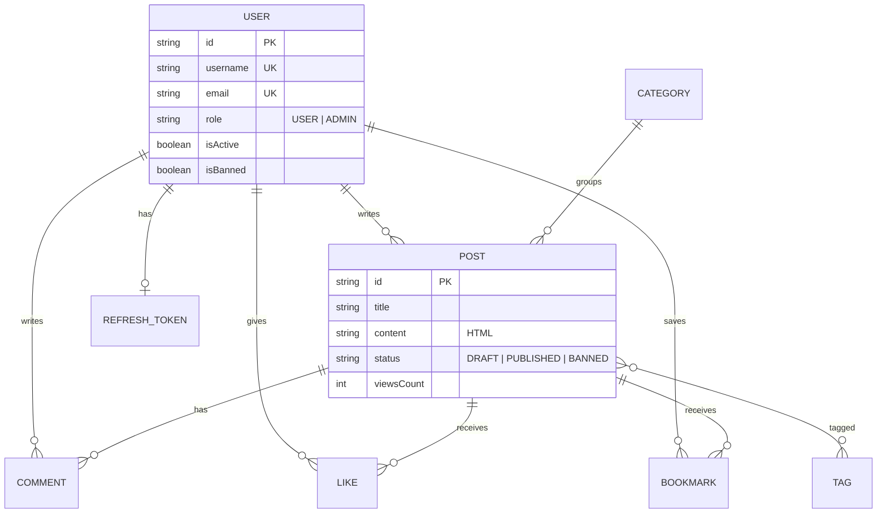

<div align="center">

# Ravayat (روایت)

**A platform for sharing and discovering personal experiences.**


🌐 **Live API:** `https://revayat-frontend.onrender.com` · 

</div>

---

## Table of Contents

- [Overview](#overview)
- [Features](#features)
- [Tech Stack](#tech-stack)
- [Project Structure](#project-structure)
- [Data Model](#data-model)
- [Authentication & Security](#authentication--security)
- [API Reference](#api-reference)
- [Getting Started](#getting-started)
- [Environment Variables](#environment-variables)
- [Deployment](#deployment)
- [Roadmap](#roadmap)
- [License](#license)

---

## Overview

Ravayat is a content platform where people write about real experiences (university entrance exams, programming careers, immigration, lifestyle) and learn from each other. This repository is the REST API behind it, built with a modular architecture where every feature (`auth`, `user`, `post`, …) owns its routes, controller, service and validation.

All successful responses share one shape:

```json
{ "status": "success", "data": { } }
```

and errors look like:

```json
{ "status": "error", "message": "Post not found" }
```

---

## Features

**Accounts & access**
- 🔐 JWT authentication with short-lived access tokens and database-backed refresh tokens
- 👤 Single active session per user (a new login invalidates the previous one)
- 🛡️ Role-based access control (`USER` / `ADMIN`), with the user's status re-checked from the database on every protected request
- 🚫 Ban, unban and deactivate accounts; admins cannot lock themselves out

**Content**
- 📝 Full post lifecycle: create, edit, delete, cover image upload, rich-text (HTML) content
- 🔎 Search across title and content, sort by latest or popularity, filter by category or tag
- 🧩 Related posts, view counter, per-user `isLiked` / `isBookmarked` flags
- 💬 Comments with ownership control (users manage their own, admins moderate all)
- ❤️ Toggle-based likes and 🔖 bookmarks, plus "my liked posts" and "my bookmarks"
- 🏆 Top authors leaderboard (ranked by total likes on published posts)
- 🏷️ Categories and tags with many-to-many post relations

**Admin**
- 📊 Dashboard statistics
- 👥 User management (search, role change, ban/unban, deactivate)
- 📰 Post moderation (change status to `DRAFT` / `PUBLISHED` / `BANNED`, delete)
- 💬 Comment moderation (global list with search, delete)
- 🗂️ Category and tag management with duplicate and in-use guards

**Quality**
- ✅ Zod validation on every mutating request
- 📄 Consistent, bounded pagination (`page`, `limit` ≤ 50)
- 🖼️ Uploads are verified by their real file signature, not just the MIME type

---

## Tech Stack

| Layer | Technology |
|---|---|
| Runtime | Node.js |
| Framework | Express.js |
| Language | TypeScript |
| Database | PostgreSQL (Neon) |
| ORM | Prisma |
| Validation | Zod |
| Authentication | JWT (access + refresh) |
| File storage | Cloudinary (via Multer) |
| Security | Helmet · CORS allowlist · express-rate-limit · bcrypt |

---

## Project Structure

```
src/
├── config/           # Database client, Multer setup
├── errors/           # AppError class
├── generated/        # Prisma generated client
├── middlewares/      # auth (protect / restrictTo), validate, validateId,
│                     # optionalAuth, parseFormArrays, rate limiters
├── modules/
│   ├── auth/         # register, login, refresh, logout, me
│   ├── user/         # profile, avatar, password, admin user management, stats
│   ├── post/         # CRUD, search, filters, related, admin moderation
│   ├── category/     # category management
│   ├── tag/          # tag management
│   ├── comment/      # comments + admin moderation
│   ├── like/         # toggle like, liked posts
│   └── bookmark/     # toggle bookmark, saved posts
├── routes/           # central router
├── types/            # global type declarations
└── utils/            # JWT, image verification, Cloudinary helpers
```

Each module follows the same pattern:

```
module/
├── module.routes.ts       # routes + middleware chain
├── module.controller.ts   # HTTP layer only
├── module.service.ts      # business logic and Prisma queries
└── module.validation.ts   # Zod schemas and inferred types
```

---

## Data Model



`Like` is unique per `(postId, userId)`, so a user can like a post only once.

---

## Authentication & Security

| Mechanism | Details |
|---|---|
| **Access token** | 15 minutes, returned in the response body, sent as `Authorization: Bearer <token>` |
| **Refresh token** | 7 days, stored in an `httpOnly` cookie **and** in the database |
| **Single session** | Login deletes all previous refresh tokens for that user |
| **Refresh check** | Refreshing re-validates the user: deactivated or banned accounts are rejected |
| **Per-request check** | `protect` loads the user from the database, so bans, deactivation and role changes apply immediately |
| **Cookies** | `SameSite=None; Secure` in production (frontend and API live on different sites), `Lax` in development |
| **Passwords** | Hashed with bcrypt |
| **Rate limiting** | Global limiter plus a stricter limiter on login and register (only failed attempts count) |
| **CORS** | Allowlist built from `FRONTEND_URL`, credentials enabled |
| **Uploads** | Real image type verified from file content, resized by Cloudinary |
| **Proxy** | `trust proxy` is set to `1` so rate limiting sees real client IPs behind the hosting proxy |

> The frontend stores the access token in `localStorage` and the refresh token only in the `httpOnly` cookie. Post HTML is sanitized on the client when rendered; server-side sanitization is on the roadmap.

---

## API Reference

Base URL: `/api`. Lists accept `?page=` and `?limit=` (default 10, max 50).

### Auth — `/api/auth`

| Method | Endpoint | Access | Description |
|---|---|---|---|
| POST | `/register` | Public | Register and receive tokens |
| POST | `/login` | Public | Login and receive tokens |
| POST | `/refresh` | Cookie | Get a new access token |
| POST | `/logout` | Cookie | Invalidate the refresh token |
| GET | `/me` | User | Current authenticated user |

### Users — `/api/users`

| Method | Endpoint | Access | Description |
|---|---|---|---|
| GET | `/top-authors` | Public | Top authors by likes and post count |
| GET | `/:username` | Public | Public profile |
| GET | `/:username/posts` | Public | Published posts of a user (paginated) |
| PATCH | `/me` | User | Update username and bio |
| PATCH | `/me/avatar` | User | Upload avatar (`multipart/form-data`, field `avatar`) |
| DELETE | `/me/avatar` | User | Remove avatar |
| PATCH | `/me/password` | User | Change password |
| DELETE | `/me` | User | Deactivate own account |
| GET | `/me/bookmarks` | User | Saved posts |
| GET | `/admin/stats` | Admin | Dashboard counters |
| GET | `/admin/users` | Admin | List users (`search`) |
| GET | `/admin/users/:id` | Admin | User details |
| PATCH | `/admin/users/:id/role` | Admin | Change role |
| PATCH | `/admin/users/:id/ban` | Admin | Ban a user |
| PATCH | `/admin/users/:id/unban` | Admin | Unban a user |
| DELETE | `/admin/users/:id` | Admin | Deactivate a user |

### Posts — `/api/posts`

| Method | Endpoint | Access | Description |
|---|---|---|---|
| GET | `/` | Public | Published posts (`search`, `sort=latest\|popular`) |
| GET | `/category/:categorySlug` | Public | Posts in a category |
| GET | `/tag/:tagSlug` | Public | Posts with a tag |
| GET | `/:id` | Public* | Single post (*adds `isLiked` / `isBookmarked` when logged in) |
| GET | `/:id/related` | Public | Related posts |
| POST | `/` | User | Create a post (`multipart/form-data`: `title`, `content`, `categoryId`, `tags`, optional `cover`) |
| GET | `/me` | User | My posts, any status |
| GET | `/me/:id` | User | One of my posts (for editing) |
| PATCH | `/me/:id` | User | Update my post |
| DELETE | `/me/:id` | User | Delete my post |
| GET | `/admin/posts` | Admin | All posts, any status (`search`) |
| PATCH | `/admin/posts/:id/status` | Admin | Set `DRAFT`, `PUBLISHED` or `BANNED` |
| DELETE | `/admin/posts/:id` | Admin | Delete any post |

### Comments — `/api/posts`

| Method | Endpoint | Access | Description |
|---|---|---|---|
| GET | `/:postId/comments` | Public | Comments of a post |
| POST | `/:postId/comments` | User | Add a comment |
| PATCH | `/:postId/comments/:id` | User | Edit own comment |
| DELETE | `/:postId/comments/:id` | User | Delete own comment |
| GET | `/admin/comments` | Admin | All comments (`search`) |
| DELETE | `/admin/comments/:id` | Admin | Delete any comment |

### Likes & Bookmarks — `/api/posts`

| Method | Endpoint | Access | Description |
|---|---|---|---|
| POST | `/:postId/like` | User | Toggle like |
| GET | `/:postId/likes` | Public | Like count and users |
| GET | `/me/likes` | User | Posts I liked |
| POST | `/:postId/bookmark` | User | Toggle bookmark |

Saved posts are served by `GET /api/users/me/bookmarks`.

### Categories — `/api/categories`

| Method | Endpoint | Access | Description |
|---|---|---|---|
| GET | `/` | Public | List categories |
| GET | `/:slug` | Public | Category with its posts |
| POST | `/admin/categories` | Admin | Create |
| PATCH | `/admin/categories/:id` | Admin | Update (duplicate name or slug rejected) |
| DELETE | `/admin/categories/:id` | Admin | Delete (blocked while it still has posts) |

### Tags — `/api/tags`

| Method | Endpoint | Access | Description |
|---|---|---|---|
| GET | `/` | Public | List tags |
| GET | `/:slug` | Public | Tag with its posts |
| POST | `/admin/tags` | Admin | Create |
| PATCH | `/admin/tags/:id` | Admin | Update (duplicate name or slug rejected) |
| DELETE | `/admin/tags/:id` | Admin | Delete |

---

## Getting Started

**Prerequisites:** Node.js 18+, a PostgreSQL database, and a Cloudinary account.

```bash
# 1. Clone
git clone <repository-url>
cd ravayat

# 2. Install dependencies
npm install

# 3. Configure environment variables
cp .env.example .env

# 4. Generate the Prisma client
npx prisma generate

# 5. Apply migrations
npx prisma migrate dev

# 6. Start the development server
npm run dev
```

---

## Environment Variables

```env
# Server
PORT=3000
NODE_ENV=development
FRONTEND_URL=http://localhost:3000

# Database
DATABASE_URL=postgresql://...

# Auth
JWT_ACCESS_SECRET=your_access_secret
JWT_REFRESH_SECRET=your_refresh_secret

# Cloudinary
CLOUDINARY_CLOUD_NAME=...
CLOUDINARY_API_KEY=...
CLOUDINARY_API_SECRET=...
```

| Variable | Notes |
|---|---|
| `NODE_ENV` | Set to `production` in deployment. It enables `Secure` and `SameSite=None` cookies and the stricter rate limits |
| `FRONTEND_URL` | Exact origin of the frontend, **without a trailing slash**. Used for CORS |
| `JWT_*_SECRET` | Use long random strings, and different values for access and refresh |

---

## Deployment

1. Create a PostgreSQL database and set `DATABASE_URL`.
2. Run `npx prisma migrate deploy` against it.
3. Set every variable above on your host, with `NODE_ENV=production`.
4. Set `FRONTEND_URL` to the deployed frontend origin.
5. Make sure the host puts exactly one reverse proxy in front of the app (required by `trust proxy = 1`).

> Free hosting tiers may put the service to sleep after inactivity, so the first request can be slow.

---
 
## Roadmap
 
- [x] Hash refresh tokens at rest
- [x] Server-side HTML sanitization for post content
- [ ] Follow system
- [ ] `OWNER` role (only the owner manages admins)
- [ ] Email verification and password reset
- [ ] Reporting system with an admin review queue
- [ ] Automated tests and CI
- [ ] Hide posts of deactivated or banned authors from public feeds
- [ ] OpenAPI (Swagger) documentation
---

## License

[MIT](./LICENSE)
